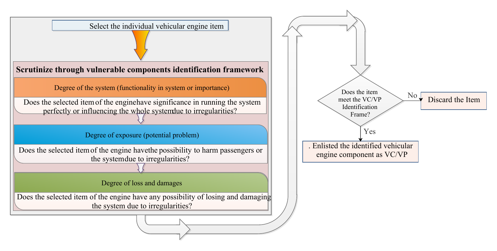
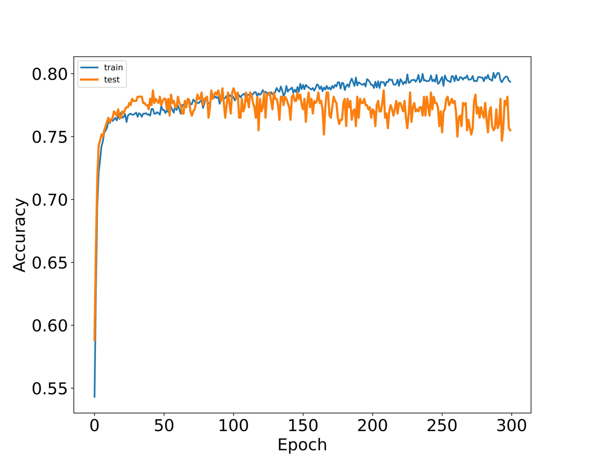
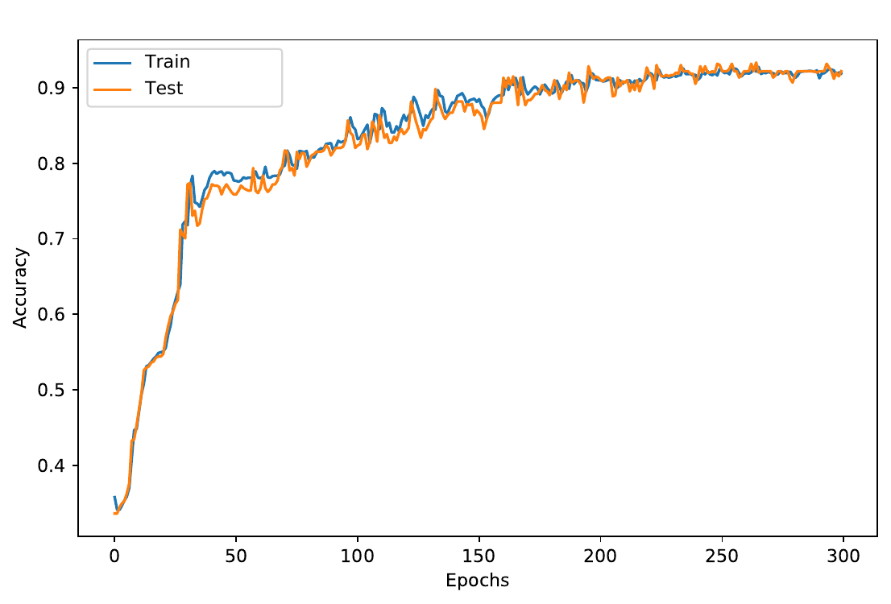
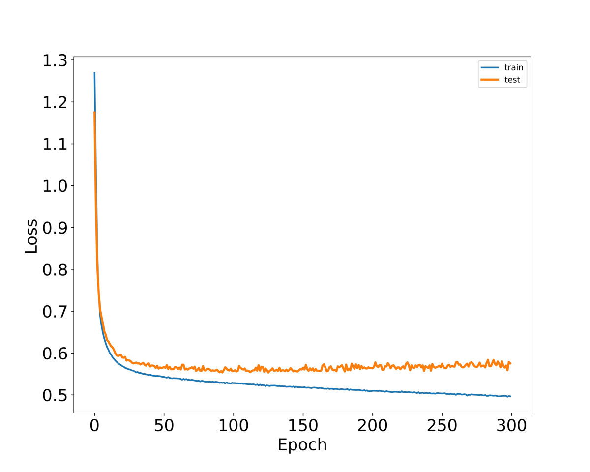
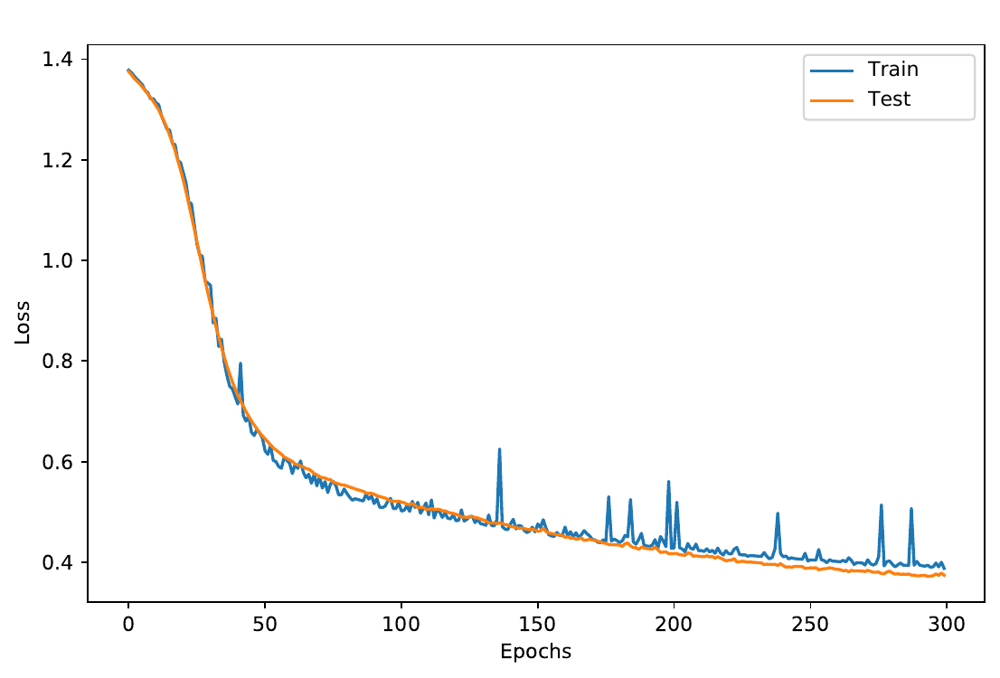
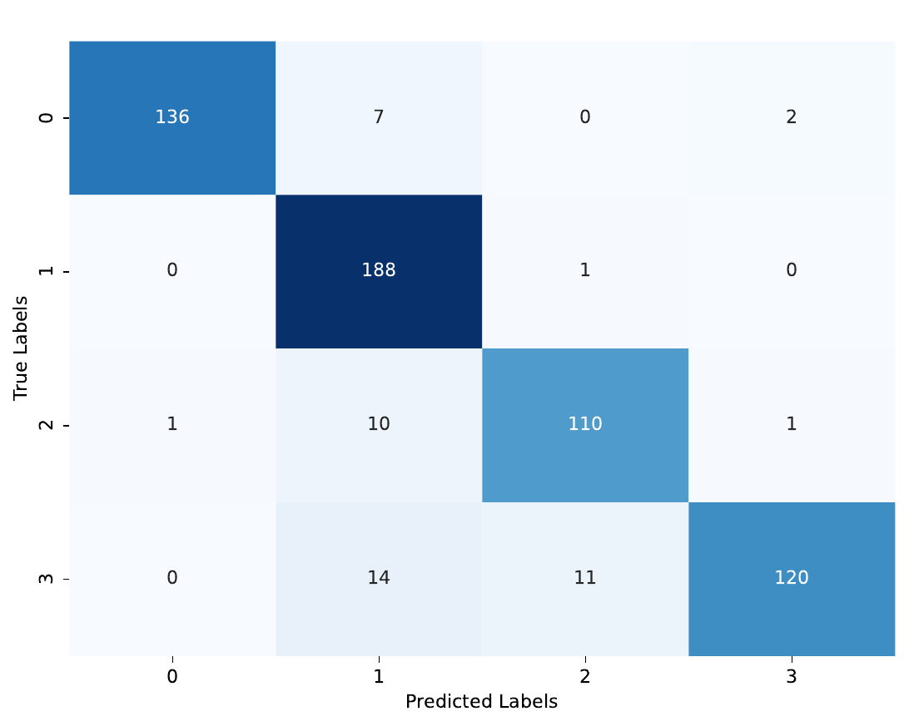
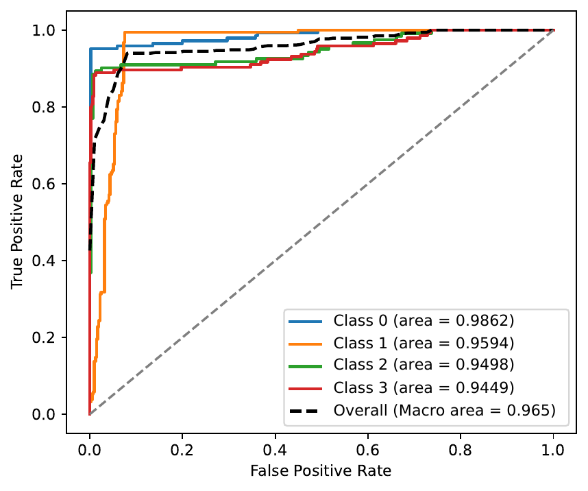
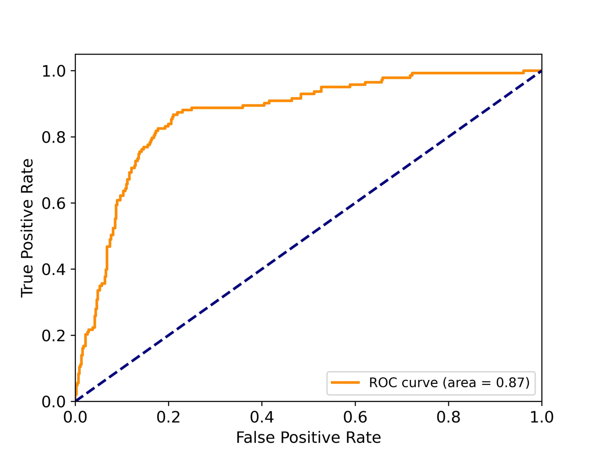
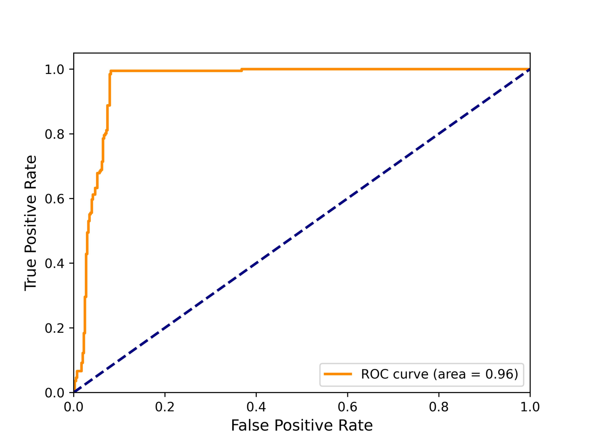

# Vehicle engine health monitoring with an attentive BiGRU-MLP and meta-learning

[](https://doi.org/10.1016/j.ymssp.2025.113141)


A deep learning decision model that classifies a vehicle engine's health as **Good, Minor, Moderate or Critical** from six vulnerable-component readings. The proposed hybrid model reaches **92.18% test accuracy, ROC-AUC 0.965 and macro F1 0.921**, with a train-test gap of only 0.12 percentage points. MLPs in TensorFlow and Keras reached at most 78.5% on test, and the one that fitted training data best (80.3%) fell to 75.5% on test.

Companion repository to the paper in *Mechanical Systems and Signal Processing* (Elsevier, 2025). [Read the paper](https://doi.org/10.1016/j.ymssp.2025.113141)

## The problem

Unexpected engine failures cost money, damage components and take vehicles off the road. Earlier MLP-based engine health models fit the training data well but generalised poorly: their training and test curves drift apart. A maintenance decision model must behave the same on new vehicles as on the data it learned from.

## Data

- **3,003 samples**, each with **6 features**: the condition of six vulnerable engine components (crankshaft, engine overheating, cylinder and piston, engine starter, engine misfires, engine lubricant).
- **4 classes**: Good, Minor, Moderate, Critical.
- Labels come from a severity-value model. Each component's severity combines its sensor reading, its weight in the engine subsystem, and 13 intensifying factors rated on a vulnerability scale. Summed severity is compared against decision thresholds.

<p align="center"><br>
<em>How the six vulnerable components were selected: importance, exposure, and potential loss and damage.</em></p>

## The model

An **attentive BiGRU-MLP trained with MAML** (Model-Agnostic Meta-Learning), in PyTorch.

| Part | Setting |
|---|---|
| Input | 6 features, sequence length 1 |
| Recurrent layer | 2-layer bidirectional GRU, hidden size 128 |
| Attention | Linear attention over BiGRU states, producing a context vector |
| Classifier | MLP with Leaky ReLU (0.01), softmax over 4 classes |
| Meta-learning | MAML: inner loop adapts to sampled tasks, outer loop updates shared weights (meta learning rate 0.01) |
| Training | Cross-entropy loss, batch size 64, 300 epochs; train, validation and test splits |

Why each part: the BiGRU captures dependencies across the component readings, attention shows which components drive a decision, and MAML trains the model to adapt quickly to new data distributions, which narrows the generalisation gap.

## Results

### Train and test curves now overlap

| Earlier: MLP, TensorFlow, RMSprop | Proposed: attentive BiGRU-MLP + MAML, PyTorch |
|---|---|
|  |  |
|  |  |

On the left, test loss stalls while training loss keeps falling: the model memorises. On the right, the curves track each other for all 300 epochs.

### Model comparison (decision accuracy, %)

| Model | Optimiser / activation | Framework | Train | Test |
|---|---|---|---|---|
| MLP | FTRL / Leaky ReLU | TensorFlow | 31.6 | 31.2 |
| MLP | Adadelta / Leaky ReLU | TensorFlow | 44.0 | 41.3 |
| MLP | Nadam / Leaky ReLU | TensorFlow | 78.9 | 73.5 |
| MLP | RMSprop / Leaky ReLU | TensorFlow | 80.3 | 75.5 |
| MLP | Adam / ReLU | Keras | 77.8 | 76.2 |
| MLP | Adamax / Leaky ReLU | TensorFlow | 77.4 | 78.0 |
| MLP | SGD / Leaky ReLU | TensorFlow | 77.9 | 78.5 |
| MLP | SGD / Leaky ReLU | PyTorch | 91.88 | 91.68 |
| **Attentive BiGRU-MLP + MAML** | **SGD / Leaky ReLU** | **PyTorch** | **92.30** | **92.18** |

Selected rows; the paper compares 17 configurations across TensorFlow, Keras and PyTorch.

### Per-class performance on the test set

| Class | Precision | Recall | F1 |
|---|---|---|---|
| Minor | 0.993 | 0.938 | 0.965 |
| Critical | 0.858 | 0.995 | 0.922 |
| Moderate | 0.902 | 0.902 | 0.902 |
| Good | 0.976 | 0.828 | 0.896 |
| **Average** | **0.932** | **0.916** | **0.921** |

Critical faults are almost never missed (recall 0.995). That is the right trade-off for maintenance: a false alarm costs an inspection, while a missed critical fault costs an engine.

| Test confusion matrix | ROC curves, proposed model (macro AUC 0.965) |
|---|---|
|  |  |

Class indices: 0 Minor, 1 Critical, 2 Moderate, 3 Good.

| ROC, MLP in TensorFlow (AUC 0.87) | ROC, MLP in PyTorch (AUC 0.96) |
|---|---|
|  |  |

## Tech stack

PyTorch · TensorFlow · Keras · BiGRU · attention · MAML meta-learning · scikit-learn metrics

## Citation

Rahim, M.A., Rahman, M.M., Islam, M.S., Joseph, C.I., Rahman, M.A., Ramasamy, D., Rahman, M.M. and Islam, M.Z. (2025). Attentive neural networks and meta-learning integration for revolutionary vehicular engine health monitoring. *Mechanical Systems and Signal Processing*, 238, 113141. https://doi.org/10.1016/j.ymssp.2025.113141

```bibtex
@article{rahim2025attentive,
  author  = {Rahim, Md. Abdur and Rahman, Md Mustafizur and Islam, Md Shofiqul and Joseph, Chukwudi Isinka and Rahman, Md. Arafatur and Ramasamy, Devarajan and Rahman, Md. Musfiqur and Islam, Md. Zohirul},
  title   = {Attentive neural networks and meta-learning integration for revolutionary vehicular engine health monitoring},
  journal = {Mechanical Systems and Signal Processing},
  volume  = {238},
  pages   = {113141},
  year    = {2025},
  doi     = {10.1016/j.ymssp.2025.113141}
}
```

## Authors and rights

This work was carried out by the full author team listed above. This repository is maintained by co-author **Md. Musfiqur Rahman** (musfiqurtonmoy@gmail.com).

<!-- Add one line here on your own contribution, e.g. "My contribution: ..." -->

Figures, tables and results are reproduced from the article with full acknowledgement: Rahim et al., *Mechanical Systems and Signal Processing* 238 (2025) 113141, https://doi.org/10.1016/j.ymssp.2025.113141, © 2025 Elsevier Ltd, reused under the authors' retained rights. The published article itself is not redistributed here.
